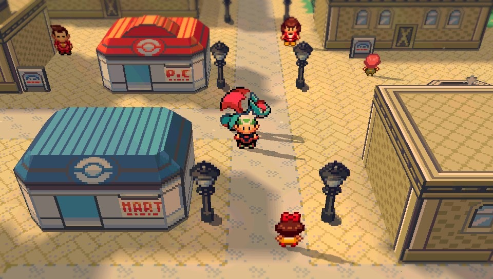
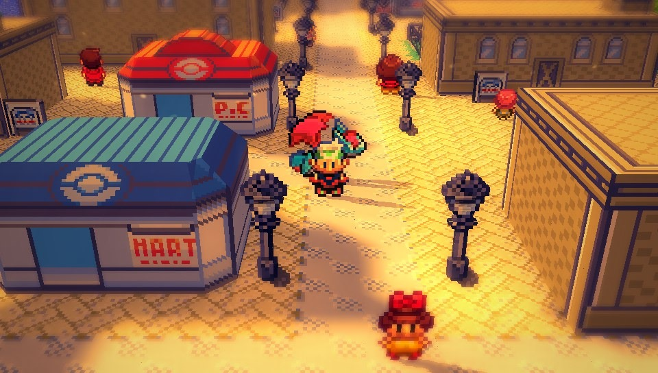
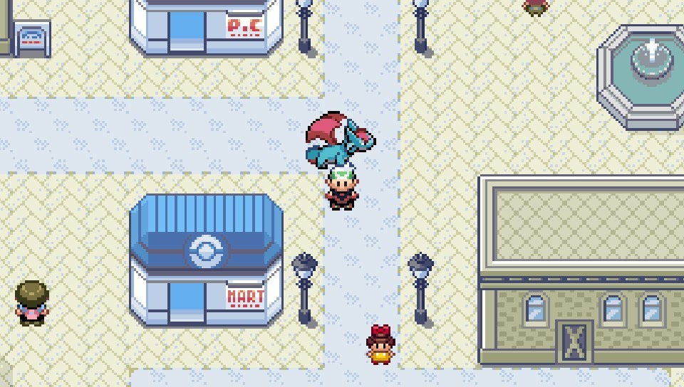
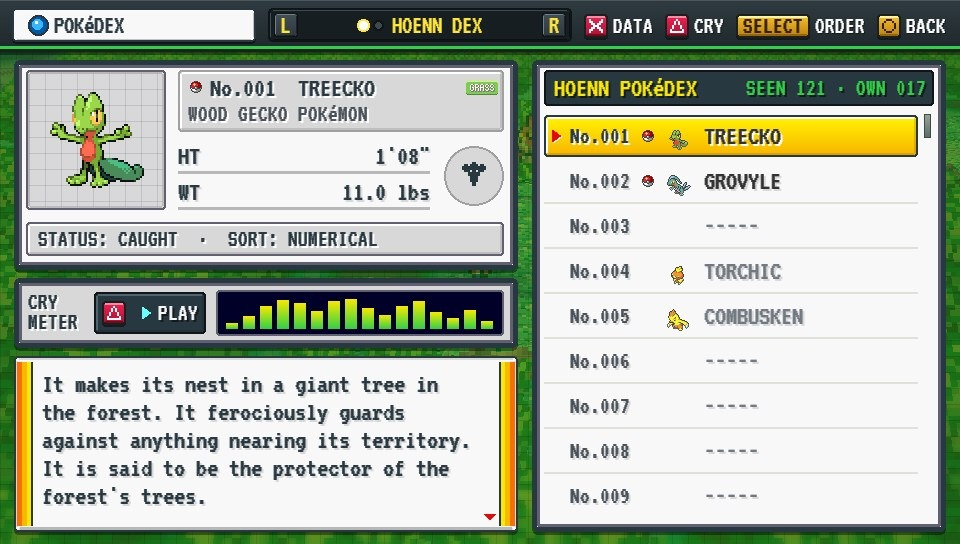
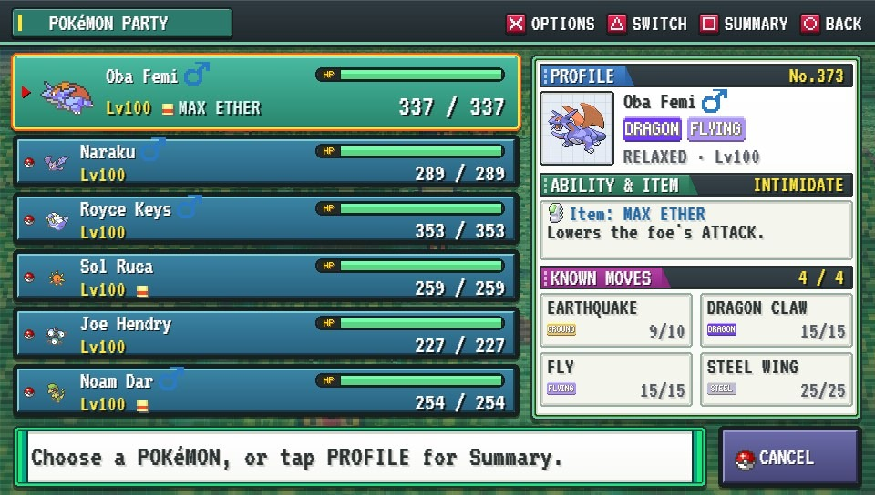
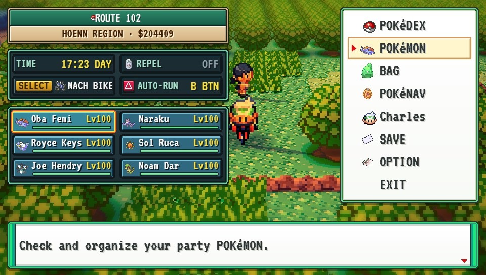
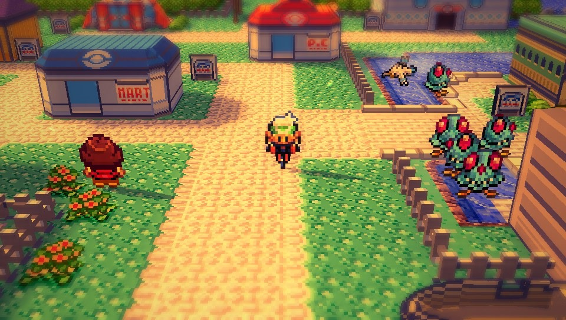
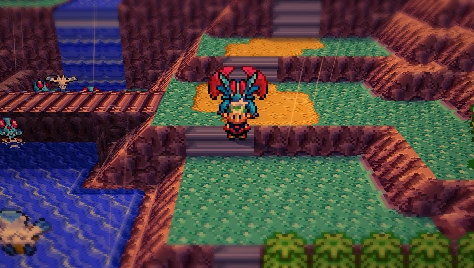
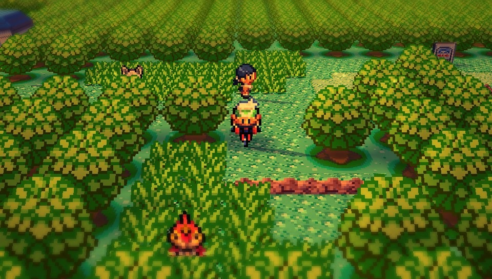

# Pokémon Emerald Vita 3DS

Unofficial native PS Vita port of Pokémon Emerald, built from the
[pret/pokeemerald](https://github.com/pret/pokeemerald) decompilation. It is not an emulator:
the game's C code is compiled for the Vita's ARM CPU, and a platform layer supplies what the GBA
hardware did. On top of it, the port brings the features of
[Emerald 3DS](https://github.com/ZallaxDev/emerald-3ds) to the Vita with vitaGL, plus an optional
**HD-2D** visual mode and 25° camera angle inspired by
[Bravely Emerald](https://github.com/marcoscodas/bravely-emerald):

- a 3D voxel overworld built live from the game's maps, with sun, shadows, day/night, weather,
  and an optional **HD-2D** post-processing mode;
- 3D battles on a stage taken from the map where the battle starts;
- a new touch interface over the 3D world that replaces the GBA menus and boxes, with six
  menu themes (including the new **GBA** skin as default);
- HGSS follower Pokémon, visible wild Pokémon in the overworld, an accelerated clock, time-based
  encounters and optional QoL extras.

The full list is under [Features](#features).

> **AI-assisted project.** The code, build scripts and documentation were written with an AI
> coding assistant (Claude Code, by Anthropic) under the supervision of HctrRB, who sets the
> direction, reviews the changes and tests every build on a real PS Vita.

> **Legal notice.** Pokémon and Pokémon Emerald are © Nintendo, Creatures Inc. and GAME FREAK inc.
> This project is not affiliated with or endorsed by them. This repository does not contain the
> game's graphics, sounds or binary data, nor any ROM: to build, you check a dump of **your own
> cartridge** and the game files are downloaded from the public decompilation
> ([docs/guides/BUILD_YOUR_OWN.md](docs/guides/BUILD_YOUR_OWN.md)). Like every decompilation, the tree still
> holds the game's code and text in decompiled form. A built VPK contains Nintendo's data:
> **do not distribute builds**.

## Screenshots

### Visual modes: 3D Normal · 3D HD-2D · Classic 2D

| 3D Normal | 3D HD-2D | Classic 2D |
|---|---|---|
|  |  |  |

### New native touch UI (GBA theme)

| Pokédex | Party | Hub & START Menu |
|---|---|---|
|  |  |  |

### 25° camera & overworld

| Town & water | Route 119 (rain & waterfall) | Tall grass & wild Pokémon |
|---|---|---|
|  |  |  |

## Features

### 3D world

- Voxel overworld built live from the game's maps: sun and shadows, day/night cycle with lit
  windows and night street lamps, weather, water reflections, 3D buildings and trees. 30 or 60 FPS
  (OPTIONS > GRAPHICS), plus classic 2D mode.
- **HD-2D mode** (OPTIONS > GRAPHICS, OFF / ON, independent of the framerate): tilt-shift depth of field, bloom and light emitters, split-tone
  colour grading and vignette, street lamp / cave lantern point lights, dynamic sun/moon light
  shafts, night fireflies, swaying foliage, 16×16 Sobel tile relief, soft contact shadows, HD-2D
  rain and adjustable camera angle (including 25°).
- 3D battles: the stage is picked from the map around the player, and the camera glides from
  the field into it.
- Visible wild Pokémon in the overworld (configurable density and encounter rate) with extended
  sprite palettes, fading smoothly into 3D battles.
- HGSS follower Pokémon, an accelerated clock and time-based encounters.

### New interface

Drawn natively at 960×544 over the 3D world. Every screen works with the buttons and with touch
(first tap selects, a second tap on the selection confirms).

- **START menu**: Pokédex (list, entry, cry, size, area), party (summary pages, switch, held
  items, field moves, move reorder), bag (pockets, sort, use / give / toss / register), PokéNav
  (map, Match Call, condition, ribbons), Fly map, trainer card (with the Frontier Pass's map and
  recorded battle), Nuzlocke tracker, options, save.
- **PC boxes**: withdraw, deposit, move POKéMON and items, summary, release, marks, jump to a box,
  wallpapers (the game's own, Walda's included) and box names.
- **Player's PC**: item storage (withdraw, deposit, toss), mailbox and mail reading on the game's
  stationery, and room / Secret Base decoration.
- **Scenes the scripts open**: Poké Mart buy / sell and decoration shops, naming keyboard (player,
  rival, POKéMON, boxes), Easy Chat (every kind, the Bard's song and the Quiz Lady included), the
  wall maps of Hoenn and the PokéNav tutorial, berry choice for the Berry Blender and Berry Crush, contest appeal choice, "choose a
  POKéMON" for the move tutor, the Day Care and other scripts, and the forget-move screen
  (level-up, HM/TM, Move Tutor).
- **Battle**: HUD with health plates, party balls, commands, moves with PP and type, targets in
  double battles, YES / NO, level-up stats and the Safari Zone; bag and party in battle (multi
  battles included); the Battle Pyramid bag, also in the field and its "bag full" steps.
- **Field**: dialogue box, YES / NO, choice lists (PC menus, NPC questions), money box, item
  obtained, PokéNav calls and zone signs, plus dialogue mirrors in 2D evolution, egg-hatch and
  trade scenes.
- **Menu themes** (OPTIONS > GENERAL > MENU COLOR): GBA (default), RED, EMERALD, CRYSTAL, TROPICAL
  and ROYAL. Each has its own colours, box shapes, bevels and font, and applies to every screen,
  the battle HUD and the zone signs.

### Extras

Physical / special split, infinite TMs, running indoors, IV / EV pages, EXP Share and EXP
multiplier, Nuzlocke rules, field HM shortcuts, button remapping.

## Status

> **Work in progress, in active testing.** Expect bugs, crashes and unfinished screens. If you
> find one, please [open an issue](../../issues/new/choose) with the bug report template: what
> you did, what happened, and the log files from `ux0:data/POKEVITA/`. Feedback on screens
> that are missing or feel wrong is very welcome.

Performance: the game sets the Vita's clocks itself (CPU 444 MHz, GPU 222 MHz; disable overclock
plugins for it, the game needs these clocks). At those clocks HD-2D **HIGH** holds an almost steady
**60 FPS** in most places (OPTIONS > GRAPHICS > FRAMERATE 60); the 3D world runs at 30 FPS by
default, which leaves the most headroom. HD-2D is **OFF** or **ON**, ON being the full HIGH look
(the LOW and MED levels of earlier releases are gone from the options).

### Not yet tested on a PS Vita

These parts are built, but have not been checked on the console yet (screen by screen, with what
is already checked: [docs/guides/UI_HARDWARE_TESTS.md](docs/guides/UI_HARDWARE_TESTS.md)):

- The Pokécenter healing machine's balls drawn on the machine in the 3D world.
- The other full-screen GBA scenes in the GBA's own format (816×544, black side bars; the Berry
  Blender is checked): slots, roulette, contest, Pokéblock eating, Battle Dome and Factory, the
  berry tag, the Hall of Fame, the diploma, the wall clock, the starter choice, Mystery Gift and
  the link card and trade menu; the GBA window frame following the menu theme. The title's main
  menu stays 16:9, as the intro.
- The other new boxes and scrolling lists of the field (Lilycove Dept. Store, Battle Frontier
  exchange and tutors; the Game Corner's are checked).
- The new screens for the Favor and Quiz Ladies and the Apprentice, the Move Deleter, the whole Move
  Relearner (its result now waits for the fanfare) and CHECK TAG for berries in the bag.
- FEED from the PokéNav CONDITION tab in a window, and every open menu coming back after a GBA
  scene.
- The PC boxes' QUICK cursor (SELECT) in every mode: ✕ withdraws, stores, moves or takes / gives at
  once, as on the GBA.
- Reading and writing mail, the Bard's song and the Quiz Lady in the new Easy Chat, the wall maps
  and Mr. Stone's PokéNav tutorial in the new PokéNav, and the Frontier Pass's MAP and RECORD as
  pages of the trainer card.
- The GBA theme on every screen: choose a POKéMON, marts, forget a move, the Move Relearner, the
  naming keyboard, Easy Chat, the player's PC, the berry choice and Nuzlocke now have the GBA top
  bar and help badges, like the others.
- The Battle Pyramid in the new UI: its START menu (REST, RETIRE, the floor), the PYRAMID BAG in the
  field and in battle, and the full-bag steps on leaving (toss from the bag, take or toss held
  items); the Battle Frontier and Battle Tents half-party choice.
- The battle fixes for Wally's battle (#8) and Gyms 6 and 7 (Natural Cure, double battle targets).
- The GRAPHICS tab (HD-2D OFF and ON with 30 and 60 FPS) and the night street lamps.
- The Flash darkness in 3D (Dewford Gym, Battle Pyramid), and the battle HUD in the Battle Palace
  and Battle Arena.
- The menu themes on every screen, and the mirrored dialogue boxes in 2D evolution, egg-hatch and
  trade scenes.

### Known issues and gaps

What has and has not been checked on a Vita yet, screen by screen:
[docs/guides/UI_HARDWARE_TESTS.md](docs/guides/UI_HARDWARE_TESTS.md).

Screens still on the GBA interface:

- Link and recorded battles, Wally's catching tutorial and the Battle Arena judgment keep the
  GBA battle HUD.
- Other screens may be missing too: give feedback on the ones you find.

Visual glitches:

- Trainer and legendary battle transitions are the GBA ones and only partly show over the 3D
  world.
- Intro and title screen margins at 16:9: the title is filled, the leaves scene uses Emerald
  3DS's continuation art and can still be improved, and the bike ride, legendary cutscenes and
  credits are not checked yet ([docs/reference/SCENES_16_9.md](docs/reference/SCENES_16_9.md)).
- Walda's FRIENDS wallpaper may draw without its frame.

3D world:

- Terrain generation bugs in some maps (they come from Emerald 3DS). Fixed so far: Route 119
  (its long bridge), Lilycove City and Mirage Island; the rest are being fixed map by map.
- Black spots on the terrain in some places: holes in the relief mesh that show the background.
- Fog in caves can look slightly odd across cave elevation changes.
- Occasional frame drops in dense areas of the 3D overworld.

Stability:

- The menu could freeze in earlier builds. The suspected cause, debug and telemetry logs written to
  the memory card, is now off in normal builds; please report it if you still see it.
- Vita3K shows a black screen; test on hardware.

## Repository layout

```
build_all.bat/.ps1/.sh               one step from your dump to EmeraldVita.vpk
CMakeLists.txt, build_vita.ps1/.sh   Vita build (preprocess → compile → link → SELF → VPK)
make_tools.mk, *_rules.mk, vita/     host tools, asset rules, link wrapper, LiveArea art
src/, include/, asm/, data/,         the pokeemerald decompilation (game code and text data;
constants/                           graphics/, sound/ and data binaries come from fetch_assets)
fetch_assets.sh/.ps1, tools/assets/  game files download (checks your ROM, then the manifest)
src/platform/                        GBA hardware emulation and main loop
src/platform/voxel/                  3D voxel world
src/platform/ui/                     the new interface (screens, widgets, themes)
src/platform/vita/                   Vita-specific features (clock, encounters, extras, stage)
assets/                              port data packed into the VPK (voxel, UI atlas, followers)
tools/                               pret host tools, UI atlas builder (tools/ui2), follower packer,
                                     generators, build checks (tools/core_boundary, tools/doc_check)
design/stitch/                       HTML mocks of the new interface
docs/                                documentation: guides (docs/guides) and reference (docs/reference)
```

## Build your own VPK

No builds are distributed: you make your own from your Pokémon Emerald cartridge. Full guide,
with every command and the common errors: [docs/guides/BUILD_YOUR_OWN.md](docs/guides/BUILD_YOUR_OWN.md)
(en español: [docs/guides/BUILD_YOUR_OWN.es.md](docs/guides/BUILD_YOUR_OWN.es.md)).

You need a Windows 10/11 PC, your Pokémon Emerald dump (`.gba`, any language, 16 MB) and a
PS Vita with HENkaku or Ensō. Nothing else has to be installed by hand:

1. **Get the repository** (`git clone`, or *Code > Download ZIP*) into a folder with no spaces
   or accents in its path and not synced by OneDrive, e.g. `C:\Emerald\pokeemerald-vita-3ds`.
2. **Double-click `build_all.bat`** in that folder and choose your `.gba` in the window it
   opens (or run `powershell.exe -ExecutionPolicy Bypass -File .\build_all.ps1 -Rom <file>`).
   It installs what is missing ([MSYS2](https://www.msys2.org) in `C:\msys64`, its packages,
   [VitaSDK](https://vitasdk.org) with vitaGL and SDL2), checks your dump, downloads the game
   files and checks each one against [tools/assets/manifest.txt](tools/assets/manifest.txt) (nothing is copied from
   the ROM), and builds everything. The first run takes 20–40 minutes.
3. **Install `EmeraldVita.vpk`** with VitaShell (*Enable unsafe homebrew* on in HENkaku
   settings). The game appears as **Emerald Vita** (title ID `PKEM00001`); saves and settings
   live in `ux0:data/POKEVITA/`. It needs the shader compiler `ur0:data/libshacccg.suprx`: if
   you do not have it, run [ShaRKBR33D](https://github.com/Rinnegatamante/ShaRKBR33D) once.

To update: `git pull` and run `build_all.bat` again (the ROM is only asked for the first time;
game files a new version needs are downloaded by themselves). The manual steps are in the guide
and in [docs/guides/BUILD.md](docs/guides/BUILD.md).

Do not share the VPK or the downloaded files: they contain Nintendo's game data.

## Controls

| Button | Action |
|---|---|
| Cross / Circle | A / B |
| D-pad or left stick | Move |
| L / R | L / R |
| START | Open or close the touch menu (field) |
| SELECT | Registered item |
| Triangle | Fast forward |
| Square | Options |
| Touch | Menu, battle action deck |

Buttons can be remapped in Options. Settings and saves live in `ux0:data/POKEVITA/`
(see [docs/reference/RUNTIME_FILES.md](docs/reference/RUNTIME_FILES.md)).

## Documentation

| Document | Covers |
|---|---|
| [docs/guides/BUILD_YOUR_OWN.md](docs/guides/BUILD_YOUR_OWN.md) ([español](docs/guides/BUILD_YOUR_OWN.es.md)) | Make your own VPK from your cartridge, step by step |
| [docs/guides/BUILD.md](docs/guides/BUILD.md) | Toolchain, build steps, CMake options, the build-time checks, installing and testing |
| [docs/guides/DEBUGGING.md](docs/guides/DEBUGGING.md) | Logs, per-frame telemetry, thread violations, crash dumps |
| [docs/README.md](docs/README.md) | Index of the technical documentation |
| [docs/reference/ARCHITECTURE.md](docs/reference/ARCHITECTURE.md) | Game side and platform side, boot, one frame, where things are |
| [docs/reference/THREADS.md](docs/reference/THREADS.md) | Cores, pacing, the game frame, who owns which data |
| [docs/reference/RENDERING.md](docs/reference/RENDERING.md) | Presentation paths, voxel passes, GBA overlay, GPU rules |
| [docs/reference/VITA_UI.md](docs/reference/VITA_UI.md) | The user interface |
| [docs/reference/VOXEL_ENGINE.md](docs/reference/VOXEL_ENGINE.md) | The 3D overworld |
| [docs/reference/SCENES_16_9.md](docs/reference/SCENES_16_9.md) | How GBA screens fill 16:9 |
| [docs/reference/ASSETS.md](docs/reference/ASSETS.md) | Where every data file comes from |
| [docs/reference/RUNTIME_FILES.md](docs/reference/RUNTIME_FILES.md) | Files the game reads and writes on the memory card |
| [design/stitch/README.md](design/stitch/README.md) | Design mocks of the new UI (Spanish) |
| [CONTRIBUTING.md](CONTRIBUTING.md) | Code standards and workflow |
| [NOTICE.md](NOTICE.md) | Licences of the ported code and credits |

## Credits

- **pret** and contributors: the pokeemerald decompilation and its tools.
- **Zallax** and the Emerald 3DS contributors: [Emerald 3DS](https://github.com/ZallaxDev/emerald-3ds),
  the source of most of what this port adds: the voxel world, the 3D battles, the followers, the
  extras and the look of the interface.
- **marcoscodas**: [Bravely Emerald](https://github.com/marcoscodas/bravely-emerald), visual
  design and shader reference for the HD-2D post-processing mode, point lights, light shafts,
  foliage sway, tile relief and 25° camera tilt.
- **gradenGnostic** and contributors:
  [pokeemerald-multiplatform](https://github.com/gradenGnostic/pokeemerald-multiplatform), the SDL2
  platform layer and voxel renderer this port starts from.
- **Rinnegatamante** (vitaGL), the **VitaSDK**, **SDL** and **Vita3K** teams, and **Niels Lohmann**
  (nlohmann/json).
- **HctrRB**: project lead, supervision and hardware testing.

## Legal

- Pokémon, Pokémon Emerald and all related names, characters, graphics, music and text are
  trademarks and copyrights of Nintendo, Creatures Inc. and GAME FREAK inc. This is a
  non-commercial fan project.
- This repository does not include the game's graphics, sounds or binary data, nor any ROM.
  `fetch_assets` checks a dump of the user's own cartridge and downloads those files from the
  public pret/pokeemerald decompilation (via pokeemerald-multiplatform); they remain the property
  of their owners. The decompiled code and text in this tree come from the same decompilation.
  Builds contain that material: don't upload, share or sell them. Use this project only with a
  legitimately owned copy of Pokémon Emerald.
- Code licences differ by origin: MIT for the multiplatform layer and original Vita code
  ([LICENSE](LICENSE)), **CC BY-NC-SA 4.0** for everything derived from Emerald 3DS. The full list
  is in [NOTICE.md](NOTICE.md).
- Provided as is, without warranty. Rights holders can request changes or removal by opening an
  issue.
